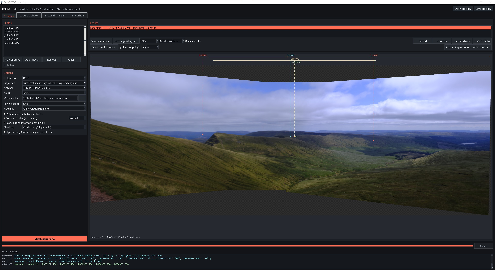
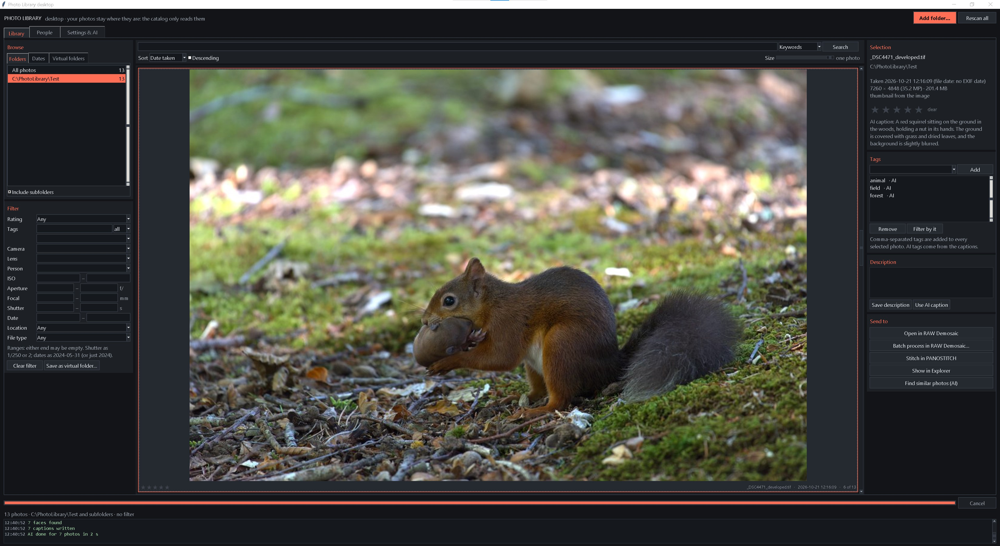

# Photo Suite




Three desktop applications for photographers. The applications work together, sharing one Python environment and one models folder.
They run on Windows and Linux, and use an NVIDIA GPU when there is one.

| App | What it does |
|---|---|
| **Photo Library** | Catalogues your photos. It only reads them: it never moves, changes, or deletes a file. Browse by the folder tree on disk or by the date taken; rate (0–5 stars); tag and describe many photos at once; filter by rating, tags, people or any EXIF value (camera, lens, ISO, aperture, shutter, focal length, date, GPS) and save filters as virtual folders. Optional AI finds faces, makes photos searchable by meaning ("dog on a beach"); and writes captions with tags. You can a selection to RAW Demosaic or PANOSTITCH. |
| **RAW Demosaic** | RAW processing: AMaZE, RCD, Malvar and bilinear demosaicing (Markesteijn for Fuji X-Trans), AI RAW denoising (NIND-Unet, RawForge). You can blend several demosaicing methods by weight, or use masked blending with SAM2. It also offers super-resolution and restoration models, and a develop tab. Batch processing from a saved settings file. When blending RAW denoise NIND-Unet, TreeNet Heavy via Rawforge, AMaZE (lesser weight should be given to NIND-Unet to preserve detail), and following with super resolution 0.8 RealSR and 0.2 RealESRGAN, results beat most commercial denoise models. |
| **PANOSTITCH** | Panorama stitching with RaCo-ALIKED + LightGlue matching (SIFT fallback): rectilinear, cylindrical and 360° projections, parallax correction, seam cutting, multi-band blending, horizon straightening, zenith/nadir editing, Hugin export. |

RAW Demosaic and PANOSTITCH also have single-file browser versions, `RAWDemosaic/rawdemosaic.html` and
`panoramamaker/panoramamaker.html`, which run the same pipelines with ONNX Runtime Web.

## Install

You need Python 3.11 or newer (the Windows installer offers to install it) and a fast internet connection. The first
install downloads 3–4 GB of packages. For the GPU you need an NVIDIA driver 580 or newer.

```
git clone https://github.com/jonathancolledge/PhotoSuite.git
cd PhotoSuite
```

- **Windows:** double-click `install_windows.bat`.
  Options: `-Models` (also download the models), `-Cpu`, `-NoShortcut`, `-Yes`, `-Uninstall`.
- **Linux:** run `bash install_linux.sh`.
  Options: `--models`, `--cpu`, `--yes`, `--no-menu`, `--uninstall`.

The installer creates one Python environment in the folder (`.venv` on Windows, `.venv-linux` on Linux), checks
that the GPU really works, and adds shortcuts or menu entries. Run it again at any time to update.

Then start the apps from the shortcuts or menu, or with `PhotoLibrary.bat`, `RAWDemosaic.bat` and `PANOSTITCH.bat`
(on Linux: `photolibrary.sh`, `rawdemosaic.sh` and `panostitch.sh`).

## Models

No models are stored in this repository; each downloads from its own publisher into `models/<App>/`.

| App | Models | How to get them |
|---|---|---|
| Photo Library | about 6 GB | Settings & AI → Download missing models, or `photolibrary_setup_models.py` |
| RAW Demosaic | | `RAWDemosaic/desktop/setup_models.py` |
| PANOSTITCH | about 450 MB | `panoramamaker/desktop/panostitch_setup_models.py`; without them it matches with SIFT |

The installers' `-Models` / `--models` option runs all three.

### Browser versions

The browser versions read their models from a folder you choose in the page. Their core processing (RAW decoding
and demosaicing; SIFT matching) needs no models, but the AI features do. To fetch those models, run this with the
suite's environment after installing:

```
.venv\Scripts\python.exe download_web_models.py          (Windows)
.venv-linux/bin/python download_web_models.py           (Linux)
```

| Page | Models folder to choose | What the script puts there |
|---|---|---|
| `rawdemosaic.html` | `models/RAWDemosaic` | NIND-Unet, RawForge, Real-ESRGAN, RealSR, SAM2.1, LaMa, MI-GAN, the Lensfun database |
| `panoramamaker.html` | `models/panoramamaker` | ALIKED + LightGlue |

Options:

- `--rawdemosaic` or `--panostitch`: fetch for one page only.
- `--mst`: also fetch the MST inpainting models. They are streamed out of a 5.7 GB archive, so this is slow.

Run RAW Demosaic's `setup_models.py` first if you want the float32 RawForge and RealSR exports; the script builds
those from the desktop's PyTorch weights.

## Licence

Photo Suite is free software under the **GNU General Public License v3.0 or later**; see [LICENSE](LICENSE).

RAW Demosaic's AMaZE and RCD demosaics are ports of [RawTherapee](https://github.com/RawTherapee/RawTherapee)'s
GPL-3.0 code, so the whole suite is GPL-3.0-or-later. Every library, model and dataset it uses is credited, with its
licence, in [THIRD_PARTY.md](THIRD_PARTY.md).

### Non-commercial parts

Photo Suite itself may be used for any purpose. Two optional parts are licensed for **non-commercial use only**, and
neither is included in the repository:

- **InsightFace's buffalo_l face models**, which Photo Library uses for People.
- **The bm3d package**, which RAW Demosaic uses for its BM3D denoise option.

Both are downloaded or installed only after you agree to their licences. Everything else works without them.

## Notes

- **Photo Library's catalog** (ratings, tags, faces, AI data and thumbnails) lives in `PhotoLibrary/library/`. Back
  up that folder.
- **Settings:** each app keeps its settings beside its own code (`…_settings.json`).
- **Updates:** updating replaces only the code. Environments, models, the catalog and settings are kept.
- **Command line:** RAW Demosaic and PANOSTITCH take files on the command line, which is how Photo Library hands a
  selection over:
  `rawdemosaic_desktop.py [files] [--list files.txt] [--settings saved.json] [--process]` and
  `panostitch_desktop.py [files] [--list files.txt]`.
